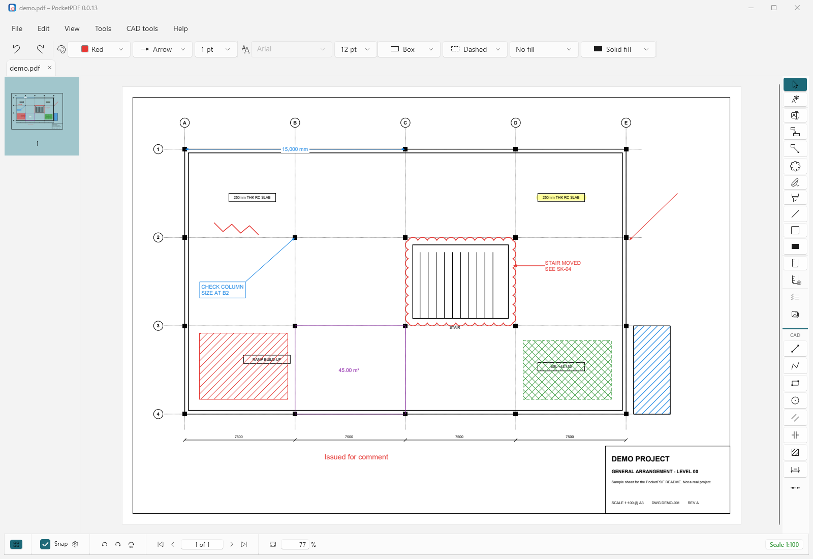
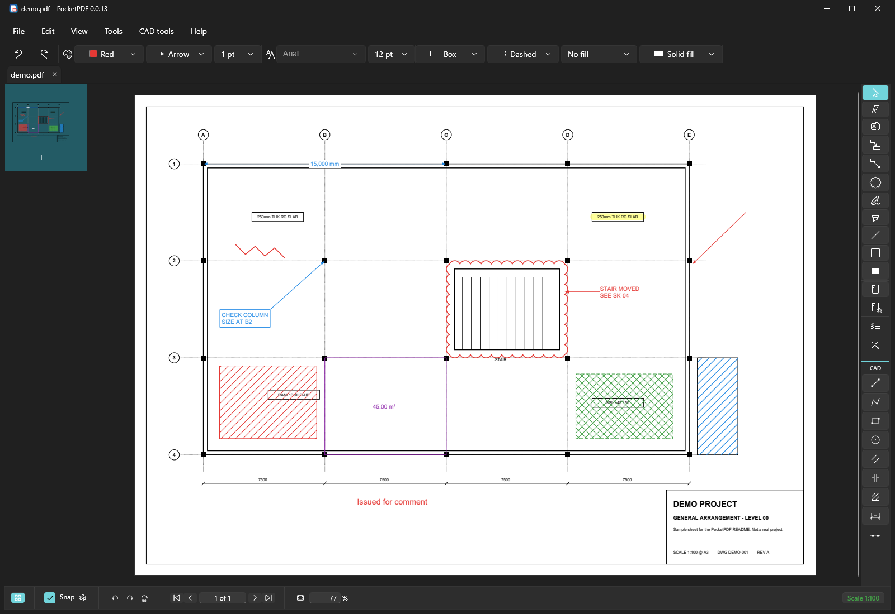

# PocketPDF

A small Windows PDF viewer and markup tool for engineering drawings. Open a drawing, mark it up, measure it to
scale, draw on it with simple CAD tools, overlay an old revision to see what changed, and save the markups back
into the PDF as standard annotations that other viewers show too.



*A made-up sample sheet with one of each kind of markup. The style of new markups is set along the top, the tools
are down the right, and pages, snap and its settings, zoom and the drawing scale (green once set) are in the status bar.*



*The same in dark mode (View ▸ Dark mode). The drawing itself stays on white paper.*

## Features

- **Markups**: text, callouts, tags, clouds, pen, highlight, lines, rectangles and masks, in a choice of colour,
  line weight, line end and text size. Select, move, edit, copy and paste them, also between open documents.
- **Fills**: any closed shape (rectangle, cloud or area, closed CAD polyline or circle) can be filled with a colour
  as hatch, crosshatch or solid.
- **Measuring**: set the sheet's scale (pick 1:50, 1:100… or calibrate on a known length), or take it from the
  sheet: a page with no scale set uses the "1:###" written furthest bottom right (NTS is skipped). The scale in the status
  bar is green once set, orange while only read off the sheet (confirm it from its menu), and red when there is none. Then measure
  distances, lengths and areas. Measurements are temporary: they go when you press Esc or pick another tool (use
  the CAD dimension tool for dimensions that stay on the sheet). Points snap to the drawing's line ends, crossings, circle centres and midpoints,
  square off the last point placed (perpendicular), and to the corners, edges, circle centres and quarter points of the
  markups and CAD lines drawn on it. The button next to Snap in the status bar picks which of these are on.
- **Check text overlaps**: clouds every piece of text on the page that lines, arrows or fills run through.
- **Placed sheets**: put a page of another PDF, or an image, on the drawing, such as the architect's plan over the
  structure. Its white paper is see-through; set its opacity, draw it all in one colour, clip it to a rectangle, and
  line it up by clicking two grid crossings on it and the same two on the drawing. Ctrl+V pastes a copied image or
  PDF file the same way. It saves in the PDF, so other viewers show it too.
- **CAD tools** (experimental, once the sheet has a scale): line, polyline, rectangle, circle, offset, trim,
  hatch, dimension and join, with sizes typed in real millimetres. They sit on their own CAD layer.
- **Compare**: overlay an old revision (old in red, new in blue), line the two up on two points, put clouds
  round every change, and export the overlay or carry on marking it up.
- **Tabs**: several documents open at once, each with its own undo history, page, zoom, scale and compare.
  PDFs opened together from Explorer, or while PocketPDF is open, all go into tabs of the one window.
- **Pages**: the page list, and first / previous / next / last buttons in the status bar, where you can also
  type a page number. Rotate a page clockwise, counter-clockwise or 180° with its markups; saving keeps it turned.
- **New sheet**: a blank page in A4 to A0 or a custom size, portrait or landscape.
- **Combine PDFs**: select PDFs in Explorer, right-click, *Combine PDFs* (add it to the Explorer menu from the
  Help menu).
- **Saved as standard PDF annotations**: other PDF viewers show the markups too.
- **Show me the tricks**: press F1 for a quick guided tour of the window.

## Tools


The drawing tools are down the right of the window and under **Tools** and **CAD tools** in the menu.
Press a tool's key to pick it.

| Tool | Key | What it does |
| --- | --- | --- |
| Select | V | Click to select, drag a window to select what it touches, drag to move. Double-click or F2 edits text. |
| Select text | S | Select the drawing's own text to copy it, or right-click to highlight it. |
| Text | T | Click to place text, or drag a box for it to wrap in. |
| Callout | C | Mark an area (box, circle or polygon), then click where the text goes. |
| Tag | G | Click the spot the arrow points at, then where the text goes. No box round the text. |
| Cloud | K | A revision cloud round a box, circle or polygon. |
| Pen | P | Freehand, in the line weight. |
| Highlight | H | A see-through marker stroke. |
| Line | L | A straight line, with an arrow, a dot or a plain end. |
| Rectangle | R | Click one corner, then the opposite one. |
| Mask | W | A white box without outline, to blank out part of the drawing. |
| Measure | M | Distances, lengths along several points, and areas, to the sheet's scale. They clear on Esc or another tool. |
| Calibrate | | Click both ends of a known length and type its real length: sets the scale. |
| Check text overlaps | | Clouds text that lines, arrows or fills run through. |
| Place PDF or image | | Puts a PDF page or an image on the page. A bar above the drawing sets its opacity, colour, clip and alignment; drag its edge to move it, a corner to resize it. |

**CAD tools** (experimental, on once the sheet has a scale). Type sizes in real millimetres in the status bar.

| Tool | What it does |
| --- | --- |
| Line | A line from two clicks, or a typed length towards the cursor. |
| Polyline | Several points; click the first one again to close it. |
| Rectangle | Two corners, or a typed width and length. |
| Circle | The centre, then a point on it, or a typed diameter or radius. |
| Offset | Copies a CAD line or circle, or a line of the drawing itself (a dashed gridline whole), to one side at the typed distance. |
| Trim | Cuts away the piece of a CAD line up to the lines crossing it, or drag a window from empty space to trim every line its edge crosses. Hold Shift to extend instead: the clicked end (or each line the window crosses) runs on to the next line, or to the page edge. Trim and offset show a small square pick cursor. |
| Hatch | Fills a region closed off by CAD lines, as hatch, crosshatch or solid, in the fill colour. |
| Dimension | Two points, then where the dimension line goes: drawn as in CAD, with ticks and the length above. Double-click it (Select tool) and type a new length: a shape both ends sit on stretches (a circle grows), a shape only the far end sits on moves, and dimensions on them follow. Changing the scale asks whether to update dimensions to it; No keeps their values, and new dimensions use the new scale. |
| Join | Joins the selected CAD lines into one polyline with clean corners. |

### Style of new markups

The bar along the top sets how new markups look. With markups selected, it changes them too.

| Group | Pickers |
| --- | --- |
| Line | Colour (also of text), line end (arrow, dot, none), line weight (0.5 to 3 pt) |
| Text | Font, text size |
| Box | Shape of clouds and callouts (box, circle, polygon), outline (cloud, dashed, solid, none), fill colour, fill type (hatch, crosshatch, solid) |

### Menus

| Menu | Has |
| --- | --- |
| File | New sheet, Open, Save, Save as, Close, Print, Exit |
| Edit | Undo, Redo, Copy, Paste, Paste in place, Delete, Select all |
| View | Line weights (off draws every line of the drawing one pixel wide), Show CAD layer, Dark mode |
| Tools | Every drawing tool, Calibrate, Check text overlaps, Place PDF or image, Rotate page, Compare with old revision |
| CAD tools | The CAD tools and Join |
| Help | Show me the tricks, add or remove *Combine PDFs* in the Explorer menu, Check for updates, About |

The status bar has the page list switch, Snap and its settings, rotate page, page buttons, fit and zoom, the cursor position in
real millimetres, and the drawing scale (click it to pick or calibrate one).

## Build and run

Needs Windows 10 or 11 and the [.NET 10 SDK](https://dotnet.microsoft.com/download).

```powershell
dotnet build
dotnet run --project src/PocketPDF
dotnet test tests/PocketPDF.Core.Tests
```

To open a file straight away: `dotnet run --project src/PocketPDF -- path\to\drawing.pdf`.

### Project layout

| Folder | What's in it |
| --- | --- |
| `src/PocketPDF` | The WPF app: the window, the markup canvas, dialogs. |
| `src/PocketPDF.Core` | Everything that can be tested without a window: reading and writing markups, geometry, scales, compare, combining. |
| `tests/PocketPDF.Core.Tests` | xUnit tests for the core library. |

PDFs are drawn with [Docnet](https://github.com/GowenGit/docnet) (PDFium) and edited with
[PDFsharp](https://www.pdfsharp.com/). PDFsharp stays at 6.2.x: later versions have a different licence.

### Version

The version is `0.x.y`, made at build time from the number of git commits since the versioning started: every
commit is a new version, 0.0.1 up to 0.0.999, then 0.1.0. Nothing needs bumping by hand. It shows in the title
bar and under Help ▸ About. A build without git (from a downloaded zip) shows the .NET default, 1.0.0.

At startup PocketPDF asks GitHub for the latest release and, when it is newer, offers to open its download page
(Help ▸ Check for updates does the same on demand). Tag releases with the version they were built from, as
`v0.x.y`; with no release published, the startup check stays quiet.

## Keyboard and mouse

### Tools

Each tool has a key: see [Tools](#tools).

While drawing: **Shift** keeps lines straight across or up (CAD tools: steps of 0, 30, 45, 60, 90°),
**Ctrl** places the point without snapping (CAD lines: straight across or up), **Esc** cancels, and again goes back to the select arrow. With a CAD tool on, just type a size: it goes into
the boxes in the status bar, and Enter applies it.

### Commands

| Keys | Does |
| --- | --- |
| Ctrl+N | New sheet |
| Ctrl+O | Open |
| Ctrl+S / Ctrl+Shift+S | Save / Save as |
| Ctrl+W | Close the tab |
| Ctrl+Tab / Ctrl+Shift+Tab | Next / previous tab |
| Ctrl+P | Print |
| Ctrl+Z / Ctrl+Y (or Ctrl+Shift+Z) | Undo / redo |
| Ctrl+A | Select all markups on the page; again for the whole document |
| Ctrl+C / Ctrl+V | Copy / paste at the cursor |
| Ctrl+Shift+V | Paste in place: the same spot on the sheet (or the same pages, for markups from several pages) |
| Delete | Delete the selection |
| F2 | Edit the selected markup's text |
| Ctrl+0 | Fit the page in the window |
| Page Up / Page Down | Previous / next page |
| Home / End | First / last page |
| F1 | Show me the tricks |

### Mouse

- **Wheel**: zoom, keeping the point under the cursor in place.
- **Middle button drag**: pan.
- **Middle button double-click**: fit the page in the window.
- **Select tool**: click to select, drag a window over empty space to select what it touches, Shift+click to
  add or remove, drag to move, double-click to edit text. Shift while dragging keeps the move straight across or
  up, Ctrl+drag drags a copy, Ctrl+Shift+drag a copy straight across or up. Ctrl+click a selected cloud's edge
  adds a corner, Ctrl+click a corner removes it.
